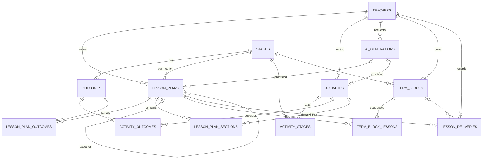

# Database schema

SwimLessonPlanner stores its data in a dedicated schema, **`SWIMLESSONPLANNER`**, on an Oracle Autonomous Database (ADB) in OCI.

## Design principles

- **The safety gate is enforced in the database.** Every lesson plan must have a pre-water-entry safety question and talking point. `NOT NULL` and `CHECK` constraints reject plans where either is missing or blank.
- **No swimmer data.** The schema stores lesson plans, how they were delivered, and teachers' notes. It never stores individual swimmers or their achievements; those stay in the pool's tracking software.
- **Outcomes in our own words.** `OUTCOMES` holds outcome descriptions written for this app. They are aligned with the Swim England Learn to Swim stages, not copied from them.
- **The library grows from use.** AI-generated and teacher-written activities and plans are stored together. `SOURCE` records where each one came from, and `AI_GENERATIONS` keeps an audit of what Claude was asked and what it returned.
- **Sharing is opt-in.** Plans are `PRIVATE` until a teacher shares them. Delivery notes are only shared when the teacher sets `NOTES_SHARED = 'Y'`.
- **Portable SQL.** The scripts avoid 23ai-only syntax, so they run on both 19c and 23ai ADB.

## Entity relationship diagram



## Tables

### Reference data

| Table | Purpose | Key columns |
|---|---|---|
| `STAGES` | Learn to Swim stages. Stages 1–7 are seeded. | `STAGE_NUMBER` (PK), `TITLE`, `SUMMARY` |
| `TEACHERS` | Qualified teacher accounts | `TEACHER_ID`, `EMAIL` (unique), `DISPLAY_NAME`, `AUTH_SUBJECT` (ID from the auth provider) |
| `OUTCOMES` | Outcomes per stage, in the app's own words | `OUTCOME_ID`, `STAGE_NUMBER`, `OUTCOME_CODE` (unique within a stage), `DESCRIPTION`, `SKILL_AREA` |

### Activity library

| Table | Purpose | Key columns |
|---|---|---|
| `ACTIVITIES` | Reusable activities for one lesson section | `SECTION_TYPE`, `TITLE`, `DESCRIPTION`, `EQUIPMENT`, `TEACHING_POINTS`, `DIFFERENTIATION`, `SAFETY_NOTES`, `SOURCE`, `STATUS` |
| `ACTIVITY_STAGES` | Stages an activity suits (many-to-many) | `ACTIVITY_ID`, `STAGE_NUMBER` |
| `ACTIVITY_OUTCOMES` | Outcomes an activity develops (many-to-many) | `ACTIVITY_ID`, `OUTCOME_ID` |

### Lesson plans

| Table | Purpose | Key columns |
|---|---|---|
| `LESSON_PLANS` | Plan header and the plan-level fields | `STAGE_NUMBER`, `TITLE`, `SAFETY_QUESTION`*, `SAFETY_TALKING_POINT`*, `EQUIPMENT`, `TEACHING_POINTS`, `DIFFERENTIATION`, `SAFETY_NOTES`, `VISIBILITY`, `STATUS`, `BASED_ON_PLAN_ID` |
| `LESSON_PLAN_OUTCOMES` | Outcomes the plan targets | `PLAN_ID`, `OUTCOME_ID` |
| `LESSON_PLAN_SECTIONS` | Ordered activity slots: warm-up, main set, contrasting activity, game, cool-down | `SECTION_TYPE`, `SEQUENCE_NO`, `ACTIVITY_ID` (optional), `INSTRUCTIONS`, `DURATION_MINUTES` |

\* Required, and cannot be blank.

A section either points at a library activity (`ACTIVITY_ID`) or holds its own `INSTRUCTIONS`. At least one of the two is required. A plan can have several `MAIN_SET` rows, ordered by `SEQUENCE_NO`.

### AI audit

| Table | Purpose | Key columns |
|---|---|---|
| `AI_GENERATIONS` | One row per Claude request | `TEACHER_ID`, `REQUEST_TYPE`, `MODEL_ID`, `PROMPT`, `RESPONSE`, `STATUS`, token counts |

### Term blocks and delivery log

| Table | Purpose | Key columns |
|---|---|---|
| `TERM_BLOCKS` | A teacher's term for one group and stage | `NAME`, `GROUP_LABEL`, `START_DATE`, `END_DATE`, `PLANNED_LESSONS`, `STATUS` |
| `TERM_BLOCK_LESSONS` | Planned lesson order within a block | `BLOCK_ID`, `LESSON_NUMBER`, `PLAN_ID` |
| `LESSON_DELIVERIES` | A plan was used on a given date, with optional notes | `PLAN_ID`, `BLOCK_ID` (optional), `DELIVERED_ON`, `RATING` (1–5), `NOTES`, `NOTES_SHARED` |

## Allowed values

| Column | Values |
|---|---|
| `SECTION_TYPE` | `WARM_UP`, `MAIN_SET`, `CONTRASTING`, `GAME`, `COOL_DOWN` |
| `SOURCE` | `TEACHER`, `AI_CLAUDE`, `AI_EDITED` (AI output that a teacher has changed) |
| `ACTIVITIES.STATUS` | `DRAFT`, `PUBLISHED`, `RETIRED` |
| `LESSON_PLANS.STATUS` | `DRAFT`, `READY`, `ARCHIVED` |
| `LESSON_PLANS.VISIBILITY` | `PRIVATE`, `SHARED` |
| `TERM_BLOCKS.STATUS` | `PLANNING`, `ACTIVE`, `COMPLETE` |
| `AI_GENERATIONS.REQUEST_TYPE` | `LESSON_PLAN`, `ACTIVITY` |
| Y/N flags | `Y`, `N` |

## Conventions

- Primary keys are `NUMBER GENERATED ALWAYS AS IDENTITY`. Junction tables use composite keys.
- Timestamps are `TIMESTAMP WITH TIME ZONE` and default to `SYSTIMESTAMP`. The application sets `UPDATED_AT` on every update; there are no triggers.
- Constraint names follow the pattern `<table>_<column>_<pk|fk|uk|ck>`.
- Every foreign key column has an index, unless it already leads a primary key or unique constraint.
- Deleting a plan cascades to its sections and outcome links. A plan that has been delivered can't be deleted, so archive it instead (`STATUS = 'ARCHIVED'`).

## Scripts

All scripts are in [`db/`](../db). Run them with SQLcl or SQL*Plus using the ADB wallet. They use `ACCEPT` prompts, which may not work in the Database Actions web SQL worksheet.

| Script | Run as | What it does |
|---|---|---|
| `00_create_schema_user.sql` | `ADMIN` | Prompts for a password, then creates the `SWIMLESSONPLANNER` user with quota on `DATA` and object-creation privileges |
| `01_create_objects.sql` | `SWIMLESSONPLANNER` | Creates all tables and indexes, and seeds Stages 1–7 |
| `90_drop_objects.sql` | `SWIMLESSONPLANNER` | Drops all tables and data but keeps the user. Asks you to type `DROP`. Safe to re-run. |
| `99_drop_schema_user.sql` | `ADMIN` | Drops the user and everything it owns. Asks you to type `DROP SWIMLESSONPLANNER`. Irreversible. |

### Example (SQLcl)

```sh
sql -cloudconfig Wallet_<db>.zip admin@<db>_high
SQL> @db/00_create_schema_user.sql

sql -cloudconfig Wallet_<db>.zip swimlessonplanner@<db>_high
SQL> @db/01_create_objects.sql
```

### Reset during development

```sh
SQL> @db/90_drop_objects.sql
SQL> @db/01_create_objects.sql
```

## Open questions

- **Separate application user.** At the moment the app would connect as the schema owner. A least-privilege `SLP_APP` user with only `SELECT/INSERT/UPDATE/DELETE` grants would be safer for production.
- **Authentication provider.** This decides what goes in `TEACHERS.AUTH_SUBJECT`.
- **Outcome content.** Who writes the outcome descriptions for each stage, and when do they get loaded?
